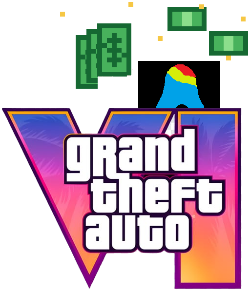
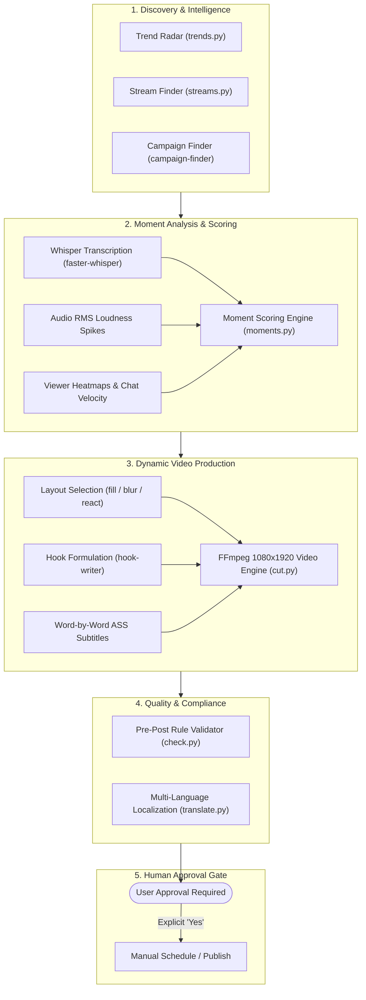

<div align="center">



# Anti-GTAVI

### The Autonomous GTA VI Content & Clipping Desk for Google Antigravity

[](https://antigravity.google)
[](.agents/skills)
[](scripts/cut.py)
[](scripts/cut.py)
[](scripts/cut.py)
[](requirements.txt)
[](LICENSE)

<p align="center">
  <b>Rockstar crafted the world of Leonida. Anti-GTAVI autonomously engineers your content.</b>
</p>

<p align="center">
  Anti-GTAVI is an end-to-end autonomous video production and trend intelligence engine built specifically for <b>Google Antigravity</b>. It scouts live streams and trending videos across YouTube and Twitch, pinpoints peak viral moments using multi-signal analysis (audio RMS, transcript hype words, viewer heatmaps, chat spikes), generates pixel-perfect 1080x1920 vertical videos with word-by-word animated captions, verifies strict platform compliance, and prepares publication-ready drafts — always gated by <b>mandatory human approval</b>.
</p>

---

[Key Features](#-key-features) • [Architecture](#-architecture) • [Agent Skills](#-agent-skills-directory) • [Quick Start](#-quick-start) • [CLI Commands](#-cli-reference) • [Safety & Rules](#-safety--ethical-guardrails)

---

</div>

## 🌟 Key Features

- **⚡ End-to-End Antigravity Orchestration**: Fully controlled via conversational prompts in Google Antigravity through the master orchestrator (`clip-desk-orchestrator`).
- **🔍 Multi-Platform Stream & Trend Scout**: Identifies breakout GTA 6 videos by views-per-hour and live streams ranked by concurrent viewers across YouTube, Twitch (keyless GQL/anonymous IRC), and Kick.
- **🎯 Multi-Signal Moment Detection**: Scans full-length VODs and videos using `faster-whisper` speech-to-text, audio volume RMS spike calculation, YouTube "most replayed" retention graphs, and live-chat velocity.
- **🎬 Professional Vertical Video Rendering**:
  - Automatically formats videos into 1080x1920 vertical format (30 fps, -14 LUFS broadcast audio normalization).
  - Multiple layout modes: `fill` (action crop), `blur` (landscape centered over blurred background), `facecam`, and `react` (split-screen with facial detection via YuNet ONNX).
  - Word-by-word karaoke-style animated captions and high-contrast hook banners.
- **🌍 Multi-Language Localization Engine**: Automatically translates spoken audio and burned captions into Spanish, Portuguese, German, Russian, and more, complete with optional Microsoft Neural TTS hook narration.
- **🛡️ Pre-Post Compliance Gatekeeper**: Automatically enforces technical specs, checks campaign duration and hashtag rules, and flags forbidden buzzwords (leaks, cheats, piracy).
- **🔒 Secure & Human-Governed**: No automated uploads or unauthorized postings. The human operator retains 100% final editorial control.

---

## 🏗️ Architecture



---

## 🤖 Agent Skills Directory

All 17 skills are native to Google Antigravity, discoverable under `.agents/skills/`:

| Skill | Purpose | Underlying Tools / Scripts |
| :--- | :--- | :--- |
| **`clip-desk-orchestrator`** | **Master Workflow Orchestrator**: runs the entire lifecycle from trend hunting to candidate selection, cutting, validation, and human sign-off. | Complete pipeline integration |
| **`setup`** | First-run workspace scaffolding: creates custom page folder, playbook, scoreboard, and media storage. | Scaffolding routines |
| **`trend-radar`** | Scrapes and ranks recent GTA 6 YouTube videos by real views-per-hour velocity. | `scripts/trends.py` |
| **`stream-finder`** | Locates active live streams on YouTube and Twitch ranked by concurrent viewers. | `scripts/streams.py` |
| **`moment-finder`** | Detects 15-40s highlight candidates scored by loudness, hype words, heatmaps, and chat spikes. | `scripts/moments.py` |
| **`clip-cutter`** | Produces a finished 1080x1920 vertical clip with styled animated subtitles and hook overlay. | `scripts/cut.py` |
| **`hook-writer`** | Generates 3 high-converting on-screen hooks (Situation, Negation, Number promise) adhering to strict character limits. | Prompt guidelines & formulas |
| **`rule-check`** | Validates resolution, frame rate, duration, campaign hashtags, mentions, and banned term filters. | `scripts/check.py` |
| **`twitch-reaction`** | Builds split-screen streamer reaction clips (streamer cam on top, gameplay below, title on seam). | `scripts/cut.py --layout react` |
| **`multilang`** | Translates clips into 5+ languages with localized subtitles and neural text-to-speech hook audio. | `scripts/translate.py` |
| **`live-mode`** | Monitors a live stream in real time, tailing chat and auto-clipping whenever chat message volume explodes. | `scripts/live.py` |
| **`campaign-finder`** | Scouts live clipping campaigns (Whop Content Rewards, Clip Tech) to log reward rates and rules. | Web search / research |
| **`questions-to-posts`**| Clusters community questions from Reddit/comments and pairs them with verified facts into HOW TO posts. | `scripts/questions.py` |
| **`secrets-map`** | Scans video transcripts to catalog verified hidden spots, rare vehicles, and Easter eggs into a structured database. | `scripts/secrets_map.py` |
| **`cheat-codes`** | Manages verified GTA 6 cheat codes and generates multi-slide carousel guides. | `references/cheats.md` |
| **`learning-loop`** | Analyzes post performance across 12h, 24h, and 72h reads to derive daily optimization rules. | `scripts/payouts.py` & CSV |
| **`playbook`** | Full strategic operational manual: daily content mix, launch-day protocols, caption templates, and safety rules. | `references/playbook.md` |

---

## 🚀 Quick Start

### 1. Requirements

- **Operating System**: Windows 10/11, macOS, or Linux.
- **Python**: 3.10 to 3.13 (64-bit).
- **FFmpeg & FFprobe**: Must be installed and accessible on PATH (installed automatically via `winget install --id Gyan.FFmpeg -e --source winget` on Windows).

### 2. Environment Setup

```bash
# Clone or open the repository in Google Antigravity
cd Anti-GTAVI

# Create virtual environment
python -m venv .venv

# Activate virtual environment
# Windows:
.venv\Scripts\activate
# Linux/macOS:
source .venv/bin/activate

# Install required dependencies
pip install -r requirements.txt
```

### 3. Running with Google Antigravity

Simply talk to the Antigravity agent in the chat:

```text
Run Anti-GTAVI. Show me today's top trending GTA 6 videos, pick the top moment from the leader, cut my first vertical clip with an engaging hook, check campaign rules, and prepare it for my approval.
```

---

## 💻 CLI Reference

All Python scripts are completely standalone and can be executed independently from the command line:

```bash
# 1. Discover trending GTA 6 videos from the past 24 hours
python scripts/trends.py --query "gta 6" --hours 24 --limit 20

# 2. Check who is live streaming right now
python scripts/streams.py --query "gta 6" --limit 15

# 3. Detect the top viral moments in a video
python scripts/moments.py "https://www.youtube.com/watch?v=..." --top 8

# 4. Cut a vertical clip with blurred background layout and hook banner
python scripts/cut.py jobs/<job_id> --pick 1 --layout blur --hook "Nobody noticed this detail"

# 5. Cut a reaction clip with face detection
python scripts/cut.py jobs/<job_id> --pick 1 --layout react --cam auto --title "Streamer REALIZED Why GTA 6 Took 13 Years"

# 6. Verify pre-post compliance against campaign rules
python scripts/check.py jobs/<job_id>/edits/clip_1.mp4 --campaign campaigns.md --caption "Watch until the end! 🎥 @Creator #GTA6 #GTAVI"

# 7. Localize clip into Spanish, German, and Portuguese with stock neural voiceover
python scripts/translate.py jobs/<job_id> --pick 1 --langs es,de,pt --voice

# 8. Record a live stream and cut chat explosions in real-time
python scripts/live.py "https://www.youtube.com/watch?v=..." --minutes 60

# 9. Log and track payouts
python scripts/payouts.py add --platform tiktok --post-url "https://tiktok.com/@..." --views 25000 --rate-per-1k 1.0 --campaign "SummerGaming"
python scripts/payouts.py report

# 10. Reclaim disk space by cleaning intermediate files or old cuts
python scripts/clean.py jobs/<job_id>               # Deletes raw source video, audio waveforms & .ass files
python scripts/clean.py jobs/<job_id> --keep-pick 4 # In edits/, keeps only clip_4 and deletes others
python scripts/clean.py jobs/<job_id> --edits       # Purges exported clips from edits/ after uploading
python scripts/clean.py --all                       # Cleans intermediate files across all jobs
python scripts/clean.py --dry-run                   # Previews files to delete without modifying anything
```

---

## 🛡️ Safety & Ethical Guardrails

> [!IMPORTANT]
> **Human-in-the-Loop Gate**: Anti-GTAVI is strictly designed with an editorial checkpoint. No script or agent will ever upload or post to any platform autonomously. You review the final MP4, preview the caption, inspect creator attribution, and execute publishing manually.

> [!CAUTION]
> **Zero Tolerance for Leaks & Exploits**: Built-in regex filters inside `check.py` and `secrets_map.py` immediately reject pirated builds, leaked footage, "play early" scams, money glitches, and AFK bots. Only publicly released footage with explicit creator credit is processed.

> [!NOTE]
> **No Income Guarantees**: Any payout metrics logged through `payouts.py` represent user-entered estimates. Campaign reward rates and view requirements are established by individual creators and campaign sponsors (e.g., Whop Content Rewards).

---

## 📄 License

This project is licensed under the MIT License — see the [LICENSE](LICENSE) file for details.

*Disclaimer: Anti-GTAVI is an unofficial open-source fan and creator automation tool. It is not affiliated with, endorsed by, or sponsored by Rockstar Games, Take-Two Interactive, Google, or Anthropic.*
